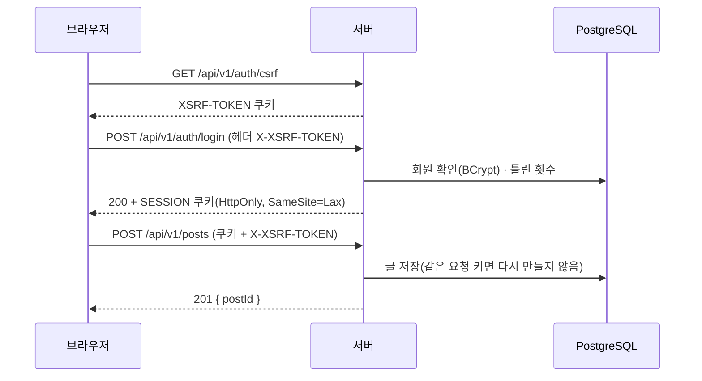
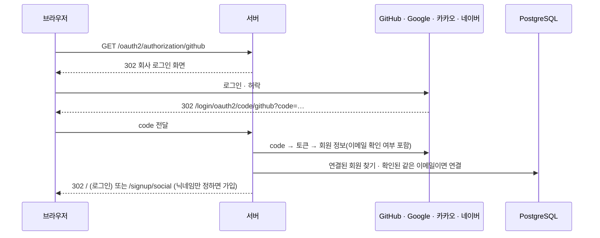
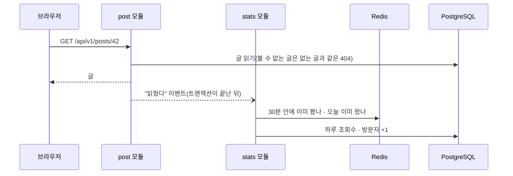

<div align="center">


# 글결

**원고지에 한 자씩 적듯, 내 블로그를 갖는 곳.**

여러 사람이 각자 블로그를 꾸리고, 방문자는 한곳에서 둘러보는 멀티 블로그 서비스

[](https://github.com/home-blog/blog/releases/tag/v0.4.0)
[](http://geulgyeol.java21.net)
[](https://github.com/home-blog/docs/blob/main/docs/4-가이드/06-API-버전과-릴리스.md)
[](https://spring.io/projects/spring-boot)
[](https://react.dev)

[바로 써 보기](http://geulgyeol.java21.net) · [바뀐 것(CHANGELOG)](https://github.com/home-blog/blog/blob/main/CHANGELOG.md) · [릴리스](https://github.com/home-blog/blog/releases) · [설계 문서](https://github.com/home-blog/docs)

</div>

<p align="center">
  
</p>

이름은 **글의 결**에서 따왔습니다. 화면은 처음부터 끝까지 **원고지** 한 가지 콘셉트로 만들었습니다. 글 카드 위에는 원고지 칸 띠가 있고, 사진이 없는 글은 첫 문장을 원고지 칸에 한 자씩 적어 썸네일로 씁니다. 글마다 **원고지 몇 매**인지도 세어 줍니다.

## 목차

- [한눈에 보기](#한눈에-보기)
- [빠르게 시작하기](#빠르게-시작하기)
- [주요 기능](#주요-기능)
- [아키텍처](#아키텍처)
- [저장소](#저장소)
- [직접 실행하기](#직접-실행하기)
- [기술 스택](#기술-스택)
- [개발 방식](#개발-방식)
- [릴리스](#릴리스)

## 한눈에 보기

| | 글결 |
| --- | --- |
| 무엇 | 티스토리형 멀티 블로그. 가입하면 내 블로그와 기본 분류가 바로 생기고, 모든 공개 글은 첫 화면에서 주제별로 모입니다 |
| 화면 | 원고지 디자인, 다크 모드, 글 목차, 원고지 매수·읽는 시간, 나란히 미리보기 글쓰기 |
| 읽기 | 주제 탭(여행·음식·취미·운동·개발), 이번 주 인기 글, 검색, 태그, 링크 미리보기 카드, RSS |
| 소통 | 댓글, 좋아요, 신고, 이미지 올리기 |
| 블로그 관리 | 대시보드(조회수·방문자 그래프), 글·분류·댓글 관리, 새 댓글 알림 |
| 서버 | 한 서버를 기능별 모듈 7개로 나누고, 모듈 사이 방향을 테스트로 지킵니다 (Spring Modulith) |
| 운영 | PR마다 자동 검사(CI·코드 리뷰·품질 분석), 릴리스를 낼 때 GitHub Actions가 실습 서버에 배포하고 릴리스 노트를 남깁니다 |

## 빠르게 시작하기

1. http://geulgyeol.java21.net 에 들어가 **회원 가입**을 누릅니다. 이메일로 받은 인증번호를 넣으면 가입이 끝납니다.
2. 가입하는 순간 **○○의 블로그**와 기본 분류 "미분류"가 만들어집니다.
3. 머리글의 **글쓰기**에서 왼쪽에 마크다운으로 쓰면 오른쪽 원고지 종이에 바로 보입니다. 주제를 고르고 저장하면 첫 화면에도 올라갑니다.
4. 내 메뉴 → **블로그 관리**에서 조회수·방문자 그래프와 새 댓글을 봅니다.

> 다음 릴리스 v0.5.0에서 GitHub·Google·카카오·네이버 **소셜 로그인**이 더해집니다.

## 주요 기능

<table>
<tr>
<td width="50%"><br/><b>글 읽기</b> — 목차, 코드 블록, 원고지 매수·읽는 시간</td>
<td width="50%"><br/><b>글쓰기</b> — 마크다운 + 나란히 미리보기, 태그, 이미지 올리기</td>
</tr>
<tr>
<td width="50%"><br/><b>대시보드</b> — 오늘·어제·누적 조회수와 방문자, 최근 30일 그래프</td>
<td width="50%"><br/><b>다크 모드</b> — 원고지 색을 그대로 어둡게</td>
</tr>
</table>

### 읽기와 둘러보기

- **첫 화면 글 모음** — 주제 탭, 이번 주 눈여겨볼 글(큰 카드), 새로 올라온 글, 이번 주 인기 글.
- **글 카드 썸네일** — 사진이 있으면 테이프로 붙인 인화지처럼, 없으면 첫 문장을 원고지 칸에. 칸 선 색은 주제마다 다릅니다. 대표 이미지는 글쓴이가 고릅니다.
- **블로그 홈** — 분류별 글 목록, 페이지, 블로그 소개, 블로그별 RSS.
- **검색과 태그** — 공개 글의 제목·본문 검색, 같은 태그의 글 모아 보기.
- **널리 퍼지게** — 카카오톡·슬랙 등에서 링크를 붙이면 미리보기 카드가 나오고, 사이트 지도와 RSS를 서버가 만듭니다.

### 쓰기

- **마크다운 글쓰기** — 서식 도구 막대, 나란히 미리보기(스크롤 맞춤), 원고지 매수가 실시간으로 바뀝니다.
- **분류·주제·태그·공개 범위** — 분류는 블로그 안의 분류(비공개 가능), 주제는 서비스 전체의 분류입니다. 태그는 5개까지.
- **이미지 올리기** — jpg·png·gif·webp, 한 장 5MB, 글 하나에 10장. 쓰지 않게 된 이미지는 정리합니다.
- **두 번 눌러도 한 번만 저장** — 같은 요청 키로 다시 오면 새 글을 만들지 않습니다.

### 소통과 블로그 관리

- **댓글·좋아요·신고** — 자기 글에는 좋아요·신고를 할 수 없고, 같은 글을 두 번 신고할 수 없습니다.
- **블로그 관리** — 글 관리(공개 범위·삭제), 분류 순서·이름·색, 댓글 관리와 새 댓글 수, 블로그 이름·소개.
- **통계** — 조회수와 방문자를 하루 단위로 세고 그래프(uPlot)로 보여 줍니다. 같은 사람이 30분 안에 다시 열면 조회수는 한 번만, 방문자는 하루에 한 번만 셉니다.

### 계정

- **회원 가입** — 이메일 인증번호(10분, 1분에 한 번, 하루 5번), 닉네임 규칙, 가입하면 블로그 생성.
- **로그인** — 서버 세션(쿠키) 로그인, 5번 틀리면 10분 잠금.
- **마이페이지** — 닉네임·소개 수정, 비밀번호 변경(다른 기기는 로그아웃), 탈퇴.
- **소셜 로그인 (v0.5.0)** — GitHub·Google·카카오·네이버. 회사가 확인한 이메일이면 닉네임만 정하고 가입, 마이페이지에서 연결·해제.

## 아키텍처

글결은 **서버 하나** 안을 기능별 모듈로 나눈 구조입니다(모듈러 모놀리스). 마이크로서비스로 쪼개지 않은 대신, 모듈 사이의 방향을 Spring Modulith 테스트로 지켜서 나중에 떼어 내기 쉽게 두었습니다.


### 모듈

| 모듈 | 하는 일 | 저장 |
| --- | --- | --- |
| **user** | 회원 가입(이메일 인증), 로그인·로그아웃·잠금, 마이페이지, 탈퇴, 소셜 로그인 | PostgreSQL, Redis(인증번호) |
| **blog** | 블로그, 분류(순서·색·비공개), 블로그 이름·소개 | PostgreSQL |
| **post** | 글 쓰기·읽기·수정·삭제, 첫 화면 글 모음, 검색, 태그, 썸네일, 링크 미리보기·RSS·사이트 지도 | PostgreSQL |
| **comment** | 댓글, 댓글 관리, 새 댓글 수 | PostgreSQL |
| **community** | 좋아요, 신고 | PostgreSQL |
| **image** | 이미지 올리기·보기·정리 | MinIO |
| **stats** | 조회수·방문자 세기, 대시보드·통계 (다른 모듈은 읽기만) | PostgreSQL, Redis(중복 막기) |
| **common** | 공통 오류 모양, API 버전(`/api/v1`), API 문서 | — |

방향은 `user ← blog ← post ← comment · community · image`입니다. 아래쪽 모듈은 위쪽을 직접 부르지 않고 **이벤트**(예: "회원이 가입했다" → 블로그 모듈이 블로그를 만든다)나 **질문 틀(인터페이스)**로 묻습니다.

### 요청 흐름

**로그인과 API 호출** — JWT 대신 서버 세션을 씁니다. 세션은 PostgreSQL에 저장되어 서버를 다시 켜도 로그인이 유지되고, 비밀번호를 바꾸면 다른 기기의 세션을 바로 끊을 수 있습니다.



**소셜 로그인 (v0.5.0)** — 회사가 준 토큰은 회원 정보를 읽는 데 한 번 쓰고 버립니다. 로그인을 마치면 위와 같은 서버 세션으로 바꿉니다.



**글 읽기와 통계** — 글을 보여 준 뒤 "읽혔다" 이벤트를 내고, 통계 모듈이 받아서 셉니다. 글 모듈은 통계 모듈을 모릅니다.



### 보안과 데이터 보호

- **비밀번호** — BCrypt 해시로만 저장합니다. 이메일 인증번호도 원문 대신 HMAC 값으로 둡니다.
- **세션과 CSRF** — 세션 쿠키는 HttpOnly·SameSite=Lax, 바꾸는 요청은 모두 CSRF 토큰(쿠키 `XSRF-TOKEN` + 헤더 `X-XSRF-TOKEN`)이 있어야 합니다.
- **권한은 서버가** — 글 수정·삭제는 주인만. 비공개 글과 비공개 분류의 글은 남에게 **없는 글과 같은 404**로 답해 있는지도 알리지 않습니다.
- **입력 검사** — 글자 수·형식은 화면에서도 보이지만 서버가 다시 검사합니다. 쿼리는 문자열을 이어 붙이지 않습니다.
- **글 본문** — 마크다운 문법만 쓰고 HTML은 글자 그대로 보입니다. 위험한 링크는 막습니다.
- **탈퇴** — 회원 줄은 남기되(남의 글에 단 댓글이 "탈퇴한 사용자"로 보이게) 이메일·닉네임·비밀번호·소개는 알아볼 수 없는 값으로 바꿉니다.
- **비밀 값** — DB·메일·소셜 로그인 열쇠는 저장소에 없습니다. 로컬은 `.env`(git 제외), 배포는 GitHub Secrets → 서버 환경 변수로만 넣습니다.

### 배포

릴리스를 낼 때만 배포합니다. GitHub Actions의 **배포** 작업에 릴리스 번호를 넣으면 ① 번호와 서버·화면 버전, CHANGELOG 절이 맞는지 확인하고 ② 서버·화면 이미지를 만들어 SSH로 실습 서버에 보내 Docker Compose로 켠 뒤 ③ 바깥 입구까지 답하는지 확인하고 ④ 태그와 GitHub 릴리스를 CHANGELOG 절로 만듭니다. 중간에 실패하면 멈추고 서버는 그대로 둡니다.

## 저장소

| 저장소 | 설명 |
| --- | --- |
| [blog](https://github.com/home-blog/blog) | **코드** — 서버(`backend/`, Spring Boot), 화면(`frontend/`, React), 개발용 Docker Compose, CI·배포 작업, CHANGELOG |
| [docs](https://github.com/home-blog/docs) | **문서** — 요구사항, 설계(ERD·아키텍처), 기능별 명세(Spec Kit: spec·plan·tasks·API 계약), 프로젝트 원칙, 쉬운 기술 가이드 |
| [docs-RESTful](https://github.com/home-blog/docs-RESTful) | **공부 자료** — RESTful API 설계를 처음부터 쉽게(자원 중심 URL, 메서드·상태 코드, 에러 형식, 페이징, 문서화)와 발표 원고 |

## 직접 실행하기

### 준비물

| 도구 | 버전 | 쓰는 곳 |
| --- | --- | --- |
| Java | 21 | 서버 |
| Maven | 3.9 이상 | 서버 빌드·실행·테스트 |
| Node.js | 22 | 화면 |
| Docker (Compose) | 최신 | 개발용 PostgreSQL·Redis·MinIO |

### 로컬 포트

| 무엇 | 주소 | 비고 |
| --- | --- | --- |
| 화면 (Vite) | http://localhost:5173 | `/api`, `/oauth2`, `/og` 등은 서버로 넘깁니다 |
| 서버 (Spring Boot) | http://localhost:8080 | API 문서 `/swagger-ui.html`, 상태 `/actuator/health` |
| PostgreSQL 18 | localhost:5432 | pgvector 이미지 |
| Redis 8 | localhost:6379 | |
| MinIO | localhost:9000 (관리 화면 9001) | 이미지 저장소 |

### 실행

```bash
git clone https://github.com/home-blog/blog && cd blog
cp .env.example .env            # 로컬 접속 정보 (처음 한 번)
docker compose up -d --wait     # PostgreSQL · Redis · MinIO

cd backend && mvn spring-boot:run          # 서버 http://localhost:8080
cd frontend && npm ci && npm run dev       # 화면 http://localhost:5173
```

- 개발 서버를 처음 켜면 **예시 데이터**(블로거 12명, 글 108개)가 자동으로 들어갑니다.
- 개발 설정에서는 인증 메일을 보내지 않고 서버 로그에 인증번호를 찍습니다. 실제 메일로 받으려면 `.env`의 `MAIL_*`를 채웁니다.
- 테스트 전체: `cd backend && mvn verify` · 화면 검사: `cd frontend && npm run lint && npm run build`
- IntelliJ에서는 실행 목록(`.run/`)의 `1. DB·Redis·MinIO 켜기` → `MyBlog 전체 (서버+화면)`을 고르면 됩니다.

## 기술 스택

### 서버

| 기술 | 버전 | 쓰는 이유 |
| --- | --- | --- |
| Java | 21 | LTS. 레코드, 패턴 매칭, sealed 인터페이스로 결과 모양을 타입으로 나눕니다 |
| Spring Boot | 4.1 | 웹(MVC), 검증, 메일, Actuator를 한 버전 묶음으로 |
| Spring Modulith | 2.1 | 기능별 모듈의 방향을 테스트로 지키고, 모듈 사이는 이벤트로 잇습니다 |
| Spring Security | 7 | 세션 로그인, CSRF, 로그인 잠금, OAuth2 소셜 로그인 |
| Spring Session JDBC | — | 로그인 세션을 PostgreSQL에. 비밀번호를 바꾸면 다른 기기의 세션을 끊습니다 |
| Spring Data JPA · Flyway | — | 표는 Flyway 마이그레이션으로만 만들고(V1~), JPA는 확인만(`validate`) |
| Spring Framework API 버전 | 7 | 주소 `/api/v1/…`. 깨지는 변경일 때만 v2를 엽니다 |
| springdoc-openapi | 3.1 | 개발 서버의 자동 API 문서(Swagger UI) |
| AWS SDK S3 | 2 | MinIO(S3 방식) 이미지 저장 |
| PostgreSQL · Redis | 18 · 8 | 기본 저장소 · 잃어도 되는 짧은 값(인증번호, 조회수 중복 막기) |

### 화면

| 기술 | 버전 | 쓰는 이유 |
| --- | --- | --- |
| React | 19 | 화면 전체 |
| TypeScript | 7 | API 응답 모양을 코드에서 검사 |
| Vite | 8 | 개발 서버(서버로 넘기는 프록시)와 빌드 |
| React Router | 7 | 화면 이동, 저장하지 않은 글이 있으면 떠나기 전에 묻기 |
| react-markdown | 10 | 글 본문 표시(HTML은 글자 그대로) |
| uPlot | 1.6 | 가벼운 통계 그래프 |
| oxlint | — | 빠른 린트 |
| 디자인 토큰 | — | `index.css` 한곳의 원고지 색(`--paper`, `--ink`, `--grid`, `--accent`)과 다크 모드 한 벌 |

### 품질과 운영

| 기술 | 역할 |
| --- | --- |
| JUnit 5 · Spring Boot Test · MockMvc | 서버 테스트 400여 개. 실제 PostgreSQL·Redis로 돌립니다 |
| Spring Modulith Test | 모듈 방향 검사 |
| Playwright | 화면을 실제 브라우저로 확인 |
| GitHub Actions | CI(서버 빌드·테스트, 화면 린트·빌드), 배포, 예시 데이터 |
| SonarQube | 품질·커버리지 분석 (JaCoCo) |
| CodeRabbit | PR 1차 코드 리뷰 (한국어) |
| Dependabot | 의존성 업데이트 |
| Docker Compose · Nginx | 개발 환경, 배포 서버(화면 컨테이너 + 서버 컨테이너 + Redis + MinIO) |

## 개발 방식

- **명세부터** — 기능마다 [docs](https://github.com/home-blog/docs)의 `specs/<번호>-<기능>/`에 무엇을(spec) → 어떻게(plan, API 계약) → 작업 목록(tasks)을 쓰고, 정하지 않은 것은 선택지와 추천안을 적어 고른 뒤에 만듭니다. 지금까지 001~010.
- **브랜치와 PR** — `main`에 직접 올리지 않습니다. `feat/…`, `fix/…`, `chore/…` 브랜치에서 PR을 열고, CI·CodeRabbit·SonarQube를 통과하면 합칩니다. 커밋 메시지에는 작업 ID(T001 등)를 적습니다.
- **릴리스** — 로컬에서 쓸 만한 묶음이 되면 버전을 올려 배포합니다. 기능이면 가운데 숫자(0.5.0), 버그 수정만이면 끝 숫자(0.4.1). 변경은 PR마다 CHANGELOG의 `준비 중` 절에 쌓입니다.
- **API 버전은 릴리스와 따로** — 칸을 더하는 변경은 v1 그대로, 칸을 빼거나 뜻을 바꿀 때만 `/api/v2`.

## 릴리스

| 버전 | 날짜 | 주요 내용 | 기록 |
| --- | --- | --- | --- |
| v0.5.0 | 준비 중 | GitHub·Google·카카오·네이버 소셜 로그인, 마이페이지 연결된 계정, 비밀번호 만들기 | [CHANGELOG](https://github.com/home-blog/blog/blob/main/CHANGELOG.md) |
| v0.4.0 | 2026-10-12 | 글 카드 썸네일(사진·원고지), 첫 화면 큰 카드, 넓은 화면 배치, 글결 마크, API 주소 버전 `/api/v1`, 자동 API 문서, 릴리스 자동 기록 | [보기](https://github.com/home-blog/blog/releases/tag/v0.4.0) |
| v0.3.0 | 2026-10-12 | 다크 모드, 글 목차, 원고지 매수·읽는 시간, 원고지 카드 디자인, 나란히 미리보기, 링크 미리보기 카드, RSS, 사이트 지도 | [CHANGELOG](https://github.com/home-blog/blog/blob/main/CHANGELOG.md) |
| v0.1.0 | 2026-10-12 | 첫 배포: 가입·로그인·계정, 블로그와 글, 탐색·검색, 댓글·좋아요·신고·태그·이미지, 블로그 관리·통계, 첫 화면 글 모음 | [CHANGELOG](https://github.com/home-blog/blog/blob/main/CHANGELOG.md) |

---

<div align="center">

만든 사람 **이재웅** · 화면 글꼴 [고운바탕](https://fonts.google.com/specimen/Gowun+Batang), [IBM Plex Sans KR](https://fonts.google.com/specimen/IBM+Plex+Sans+KR)

</div>
